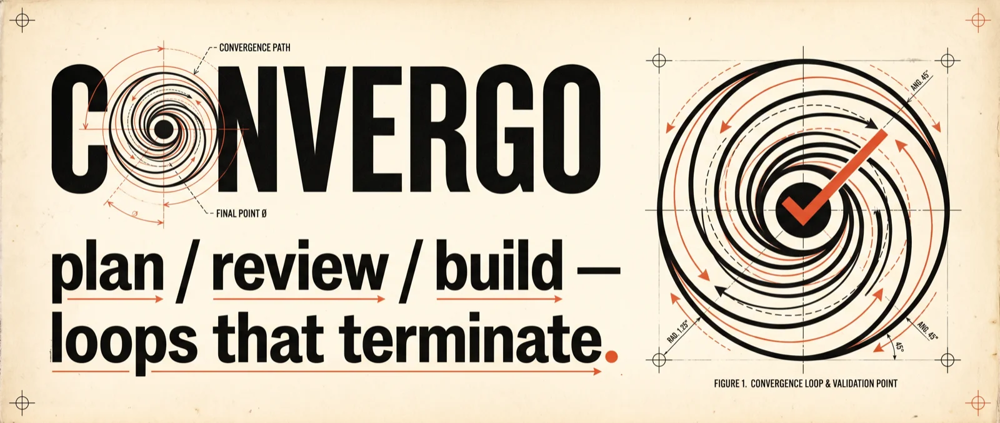
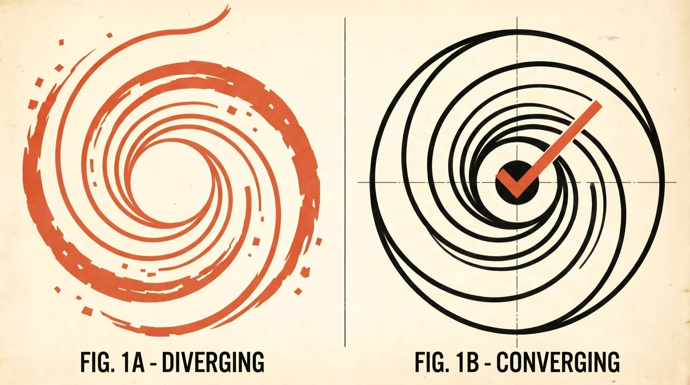
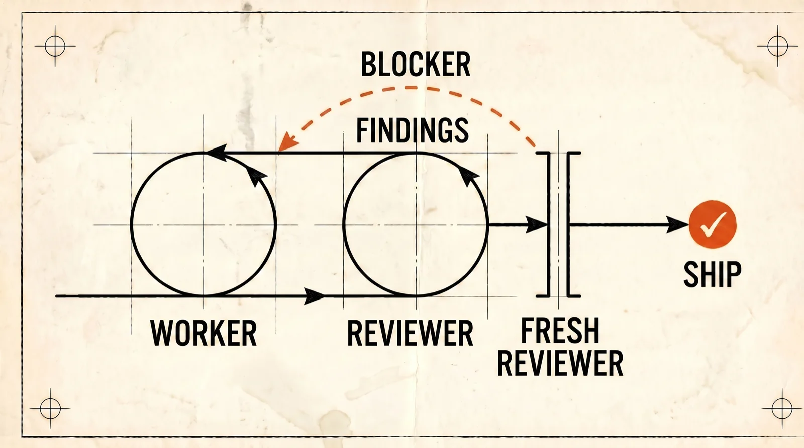

<div align="center">


# Convergo

**Plan → review → build loops for coding agents — that actually terminate.**

[](LICENSE)
[](#skills)
[](#install)

[Quick Start](#quick-start) · [Why](#why-convergo-exists) · [How It Works](#the-rules-that-make-it-converge) · [Skills](#skills) · [Install](#install)

</div>



Agent-written code needs review, and agent review needs a loop: find issues,
fix them, review again. The dirty secret is that this loop often **doesn't
converge** — each round adds patches, prose, and pseudo-code instead of
closing in on done. Convergo is a plugin that bounds that loop by
construction. **It exits only when a fresh reviewer — a newly spawned session
that has never seen the code — completes a full pass and reports no blockers.
After three rounds without one, it stops and escalates to you instead of
churning.**

It is a convergence-focused fork of
[Compound Engineering](https://github.com/EveryInc/compound-engineering-plugin):
CE gets the plan-first, review-everything shape right; Convergo makes the
loops terminate.

**Built for** correctness-critical, reviewable work with AI coding agents.
Not for quick spikes or throwaway prototypes — see [Cost and Fit](#cost-and-fit).

## Quick Start

Claude Code — everything ships with the plugin:

```text
/plugin marketplace add gomilesf/convergo
/plugin install convergo
```

Codex and every other host: see [Install](#install) — every host is a
single plugin install.

Then, in a repo with an issue to work on:

```text
/cvg-plan-loop create a plan for issue #42
... review the plan yourself ...
/cvg-build-loop docs/plans/42-plan.md
```

## Why Convergo Exists



An unbounded agent review loop can fail to settle — and the failure mode is
not "the reviewer found a bug" (that's the loop working). The failure mode is
**divergence**:

- Plan review discovers one symptom per round instead of the missing surface,
  invariant, or behavior decision underneath them all.
- The planner responds by adding more text instead of repairing the plan's
  structure.
- Code review pushes the worker into local patches even when the finding is
  really a plan gap, a contract gap, or a systemic design gap.
- Every round makes the artifact larger, vaguer, and more likely to
  accumulate pseudo-code — which spawns a new class of review findings.

One missing invariant across eight surfaces should become **one plan repair,
not eight rounds of local patches**. Convergo's rules exist to force exactly
that.

## What a Run Looks Like

`/cvg-build-loop docs/plans/rate-limit-plan.md` on Claude Code, condensed:

```text
orchestrator  records base commit and worktree state,
              spawns a WORKER session with the plan, ends its turn (no polling)

worker        implements slice by slice with TDD, one commit per slice,
              keeps impl notes for the reviewer
              -> "Implementation round complete. Base a1b2c3, head d4e5f6.
                  Verification: 41 tests pass. Known gaps: none."

orchestrator  spawns a FRESH REVIEWER session

reviewer      reads plan + diff, dispatches correctness/testing sub-reviewers,
              merges their JSON findings
              -> "Not ready. F1 (P1): retry path drops the rate-limit header.
                  F2: plan never decided burst behavior — contract gap."

orchestrator  returns the findings verbatim to the SAME worker session

worker        intake first, then repair: F1 is implementation-owned -> fixes it
              F2 is a contract gap -> STOPS and reports instead of patching
              around the missing decision

you           decide burst behavior (or send it back through the planner)

worker        finishes the repair -> new head commit

reviewer      (same session) focused re-review of the fixes -> pass

orchestrator  spawns a NEW FRESH REVIEWER session

reviewer      (new session) full first pass
              -> "Ready with fixes. No blockers. Two P2 notes."

orchestrator  exits the loop: base -> head, findings history, P2 list for you
```

Three properties make this a loop and not a spiral: the worker never patches
around a missing decision, review feedback goes back to the session that has
the context, and the exit judgment always comes from a reviewer who has never
seen the code before.

## The Rules That Make It Converge



Every rule below is written into the skills, not just described here. What
can be machine-checked is — the findings schema is validated per finding,
and the generated platform builds are byte-checked by tests; the behavioral
rules are prompt contracts, exercised end-to-end by the release smoke test.

**Feedback goes through intake, not straight to edits.** The planner or
worker that produced the artifact classifies each finding first — code bug,
plan gap, contract gap, systemic design gap, stale, or blocked on a missing
decision — and repairs only what its role owns. Workers stop and call back on
plan, contract, and systemic gaps instead of patching forward.

**Findings carry evidence, not vibes.** Sub-reviewers return findings against
a shared schema: `P0`–`P3` severity, discrete confidence anchors, a
quote-the-line gate for high-confidence claims. Low-confidence findings are
dropped at merge unless they are critical, and P3 style findings are never
emitted at all — style belongs to tooling, not the loop. Reviewers run under
a fresh-review evidence boundary — no project memory, no prior sessions, no
rollout history; only the plan, the diff, and the repo. The worker's impl
notes are the one
deliberate exception: they ship with the diff so the reviewer sees declared
deviations, assumptions, and accepted gaps. The notes carry decisions, never
review provenance — no round numbers, finding IDs, or fix-status claims — so
a fresh reviewer inherits the decision record, not the previous reviewer's
search map.

**Exit requires a fresh reviewer.** A same-reviewer pass is never the exit
condition. After repairs, the original reviewer re-reviews the fixes; the
loop exits only when a newly spawned reviewer completes a full first pass
with no blockers. "Ready with fixes" (only non-blocking P2 notes remain)
counts as passing — the loop does not churn on nitpicks.

**The loop is capped.** Three rounds without a clean fresh pass stops the
loop and escalates to you with all open findings. Findings already
adjudicated invalid cannot re-block a later round without new evidence (the
adjudication ratchet). Bounded convergence is a rule, not a hope.

**Plans are right-sized decision artifacts.** `/cvg-plan` classifies
complexity first (brief / standard / full); only cross-cutting work gets the
full surfaces + invariant-matrix treatment. Plans never contain code. Open
behavior decisions that bind multiple slices go into a behavior contract
rather than being invented downstream.

**The loop runs unattended but finds you at three defined points.** The
build loop starts only when you explicitly trigger it on a reviewed plan —
this gate is where your judgment counts most: check that the behavior
contract records decisions you actually want, that each slice's "done when"
is verifiable, and that the invariant matrix covers every surface you know
about. Mid-loop, a worker blocked on a missing behavior decision stops and
routes the question to you instead of inventing an answer. And when the
round cap trips, the escalation lands with you.

## Two Ways to Use It

**Standalone skills** (any supported host): drive each step yourself. With no
orchestrator, the skills route blocking questions to you directly.

```text
/cvg-plan -> /cvg-plan-review -> (fix via /cvg-plan-review-feedback)
-> /cvg-work -> /cvg-code-review -> (fix via /cvg-code-review-feedback)
```

**Orchestrated loops** (Claude Code and Codex): the session becomes an
orchestrator that spawns and supervises real specialist sessions.

```text
discuss goal
-> /cvg-plan-loop        planner <-> fresh plan reviewers, until clean
-> human reviews and questions the plan
-> /cvg-build-loop       worker <-> fresh code reviewers, until clean
-> final fresh code review
-> required QA gates, if any
-> done
```

The loop skills share one protocol (`cvg-multi-session`), bound to the host
platform before anything else runs: specialists are Codex threads (callbacks
via `send_message_to_thread`, heartbeat waiting) or Claude Code background
agents (final-message callbacks, task-notification waiting). Each platform's
build ships only its own transport mechanics — the copies under
`plugins/codex` and `plugins/claude` are generated from one canonical source.
Specialist identity always comes from the platform tool result, never from
the specialist's own prose.

## Skills

| Skill | Purpose | Platforms |
| --- | --- | --- |
| `/cvg-plan` | Read an issue and codebase, then write a sliced plan with an invariant matrix when needed | Claude Code, Codex, generic |
| `/cvg-plan-review` | Review a plan against the actual codebase for missing surfaces, incomplete slices, and wrong invariants | Claude Code, Codex, generic |
| `/cvg-plan-review-feedback` | Classify and handle plan-review blockers inside the planner session | Claude Code, Codex, generic |
| `/cvg-work` | Execute a plan slice by slice with TDD and implementation notes | Claude Code, Codex, generic |
| `/cvg-code-review` | Review implementation against the plan and contract, separating code bugs from contract gaps | Claude Code, Codex, generic |
| `/cvg-code-review-feedback` | Classify and handle code-review blockers inside the worker session | Claude Code, Codex, generic |
| `/cvg-plan-loop` | Orchestrate planner -> fresh plan review -> repair -> final fresh review | Claude Code, Codex |
| `/cvg-build-loop` | Orchestrate worker -> fresh code review -> repair -> final fresh review -> QA gates | Claude Code, Codex |

A ninth skill, `cvg-multi-session`, ships alongside these: the shared
protocol (transport binding, callbacks, waiting, feedback routing, exit
gates) that the two loop skills bind to. It is internal — you never invoke
it directly.

### Auxiliary Personas

`/cvg-plan`, `/cvg-plan-review`, and `/cvg-code-review` fan out to a small
reviewer/researcher set adapted from CE. Every persona is a skill-local prompt
asset under the owning skill's `references/personas/`, dispatched as a generic
subagent — no platform agent registration on any host. Code-review personas
return raw JSON against the shared findings schema
(`cvg-code-review/references/findings-schema.md`).

| Persona | Used by | When |
| --- | --- | --- |
| `best-practices-researcher` | `/cvg-plan` | non-obvious design work |
| `repo-research-analyst` | `/cvg-plan` | always |
| `correctness-reviewer` | `/cvg-code-review` | always |
| `testing-reviewer` | `/cvg-code-review` | always |
| `security-reviewer` | `/cvg-code-review` | auth, input, permissions, data handling |
| `adversarial-reviewer` | `/cvg-code-review` | large or high-risk diffs |
| `reliability-reviewer` | `/cvg-code-review` | error handling, retries, timeouts, jobs |
| `feasibility-reviewer` | `/cvg-plan-review` | standard and full plans |
| `security-lens-reviewer` | `/cvg-plan-review` | auth, data, external APIs, secrets |
| `scope-guardian-reviewer` | `/cvg-plan-review` | many slices or scope creep |

### Working Artifacts

Convergo leaves a durable paper trail in the repo:

- `docs/plans/<issue-id>-plan.md` — the plan (`<issue-id>` is the issue
  number or a slug); `<issue-id>-contract.md` beside it when a behavior
  contract is warranted
- `docs/impl-notes/<issue-id>.md` — worker decisions, deviations, and flagged
  assumptions the reviewer needs

Per-run review scratch deliberately lives outside the repo — inside the
worktree it would leak earlier rounds' findings to the next fresh reviewer:

- `/tmp/convergo/cvg-code-review/<run-id>/` and
  `/tmp/convergo/cvg-plan-review/<run-id>/` — `review.json` (verdict, merged
  findings, auxiliary coverage) plus one JSON per sub-reviewer. Ephemeral;
  inspect during or right after a run.

## Cost and Fit

**What a loop spends.** A build-loop run is one worker session, a fresh
reviewer per round (each dispatching two or more sub-reviewer agents),
focused re-reviews, and a final fresh pass — expect roughly an order of
magnitude more tokens than telling an agent to "just implement it" (our
observed runs, not a benchmark). That is the price
of independent review, and it is why the loop is capped at three rounds. The
six base skills used standalone cost roughly what any single-session skill
costs; `claude plugin details convergo` shows the per-skill token numbers.

**What the loops require.** Orchestration needs real sub-session primitives:
background agents on Claude Code, threads on Codex. If the host cannot
provide them, the skills stop with a tool-layer blocker rather than
role-playing the specialists inline. Generic hosts (Cursor, OpenCode, Pi,
Gemini) get the six base skills only.

**When to use something else.** Quick spikes, throwaway experiments, and
rapid visual UI iteration do not need a bounded review loop. Use the base
planning and review skills selectively, or skip Convergo entirely.

## Install

### Claude Code

```text
/plugin marketplace add gomilesf/convergo
/plugin install convergo
```

Ships all nine skills. Specialist reviewer and researcher behavior lives
inside the skills as local persona prompts, so the plugin install is
self-contained.
`claude plugin details convergo` shows the component inventory and the
projected token cost per skill.

### Codex App

1. Open **Plugins** from the sidebar, click **Add plugin marketplace**.
2. Source: `gomilesf/convergo`, Git ref: `main`, sparse paths blank.
3. Add the marketplace, select **Convergo**, install **convergo**, then
   restart Codex. The install is self-contained; no extra agent setup step.

### Codex CLI

```bash
codex plugin marketplace add gomilesf/convergo
codex   # inside: /plugins -> Convergo -> install convergo
```

Restart Codex after the install completes. For a non-default profile, run
every step against the same `CODEX_HOME`:

```bash
CODEX_HOME="$HOME/.codex/profiles/work" codex plugin marketplace add gomilesf/convergo
CODEX_HOME="$HOME/.codex/profiles/work" codex
```

Earlier convergo versions installed typed `cvg-*` agents into
`$CODEX_HOME/agents/convergo/`. Current skills no longer use them; remove that
directory (and `$CODEX_HOME/convergo/install-manifest.json`) if present.

### Cursor

```text
/add-plugin convergo
```

### OpenCode

Add to your global or project `opencode.json`, then restart OpenCode. The
OpenCode plugin registers the base-only skills under `plugins/generic/skills`.

```json
{
  "plugin": ["convergo@git+https://github.com/gomilesf/convergo.git"]
}
```

### Pi

```bash
pi install git:github.com/gomilesf/convergo
```

### Gemini CLI

```bash
gemini extensions install https://github.com/gomilesf/convergo
```

### Upgrading

Installs resolve by version: upgrades need a version bump on the marketplace
side and an explicit update on yours. (`convergo-plugin` is the marketplace's
registered name; `convergo` is the plugin inside it.)

```text
/plugin marketplace update convergo-plugin    (Claude Code)
/plugin update convergo
```

```bash
codex plugin marketplace upgrade convergo-plugin   # Codex CLI
codex plugin add convergo@convergo-plugin
```

## Local Development

```bash
bun install
bun run sync           # regenerate plugins/*/skills from skills-src/
bun run validate       # productization metadata checks
bun test               # metadata + skill convention tests
bun run plugin:validate
bun run eval:trigger   # LLM eval: skill descriptions route the right prompts
```

### Source layout and generated builds

`skills-src/` is the single source of skill content. `bun run sync` generates
the platform roots: it strips `<!-- codex -->` / `<!-- claude -->` marker
blocks so each platform build carries only its own transport mechanics, and
it renders the loop skills' `references/cvg-multi-session-protocol.md` copies
from the canonical `skills-src/cvg-multi-session/SKILL.md`. Never edit
generated files by hand; `bun test` byte-checks every platform copy against
the transformed source.

The other static tests guard the contracts that keep the loop sound: the
findings schema ships with every `cvg-code-review` copy, the
stage-calibration block stays identical across skills, and agent prompts
contain no dangling references.

### Trigger-routing evals

`eval:trigger` replays the routing prompts in `evals/trigger/cases.json`
against the current `skills-src/` descriptions through `claude -p`, with
frozen descriptions of real competing skills (compound-engineering, built-in
review commands) in the candidate list, so convergo must win against a
realistic install. Cases cover per-skill positives, paraphrases that avoid
convergo vocabulary, boundary prompts with accept-either answers, calibration
prompts a distractor must win, and no-skill negatives. Run it after changing
any skill `description`; add `-- --runs 3` to check stability and
`EVAL_MODEL=sonnet` to cross-check with a stronger judge. It costs a few LLM
calls, so it is not part of `bun test`.

### End-to-end smoke test

Before releases that touch the loop skills, run the manual gate:
[docs/loop-smoke-test.md](docs/loop-smoke-test.md), a seeded-bug micro
build-loop that exercises spawn, fresh review, feedback-to-same-worker,
focused re-review, and the final fresh exit on the Claude Code transport.

### Load This Checkout Directly

Claude Code:

```bash
claude --plugin-dir "$PWD/plugins/claude"
```

Codex CLI:

```bash
codex plugin marketplace add "$PWD"
codex   # /plugins -> Convergo -> install convergo
```

OpenCode:

```json
{
  "plugin": ["/path/to/convergo"]
}
```

Pi:

```bash
pi -e "$PWD"
```

Gemini CLI:

```bash
gemini extensions install "$PWD"
```

## Repository Layout

```text
skills-src/        Canonical skill sources (with platform marker blocks)
plugins/codex/     Codex plugin root: nine Codex-stripped skills
plugins/claude/    Claude Code plugin root: nine Claude-stripped skills
plugins/generic/   Base-only skill root for generic hosts
evals/             Trigger-routing eval cases (run with bun run eval:trigger)
.claude-plugin/    Claude Code marketplace metadata
.agents/plugins/   Codex custom marketplace descriptor
.cursor-plugin/    Cursor marketplace metadata
.opencode/         OpenCode package entrypoint
.pi/               Pi extension entrypoint
src/               Productization validation library + platform-content transforms
scripts/           Sync, validation, and eval text interfaces
tests/             Metadata and skill convention tests
docs/              Productization notes and the loop smoke-test runbook
```

## License and Attribution

Convergo is MIT licensed. Portions of the skill and agent prompt content are
adapted from the MIT-licensed
[Compound Engineering](https://github.com/EveryInc/compound-engineering-plugin)
plugin. See [THIRD_PARTY_NOTICES.md](THIRD_PARTY_NOTICES.md).

<div align="center">
<sub>README art is AI-generated — prompts and style system in <a href="docs/assets/art-prompts.md">docs/assets/art-prompts.md</a>.</sub>
</div>
